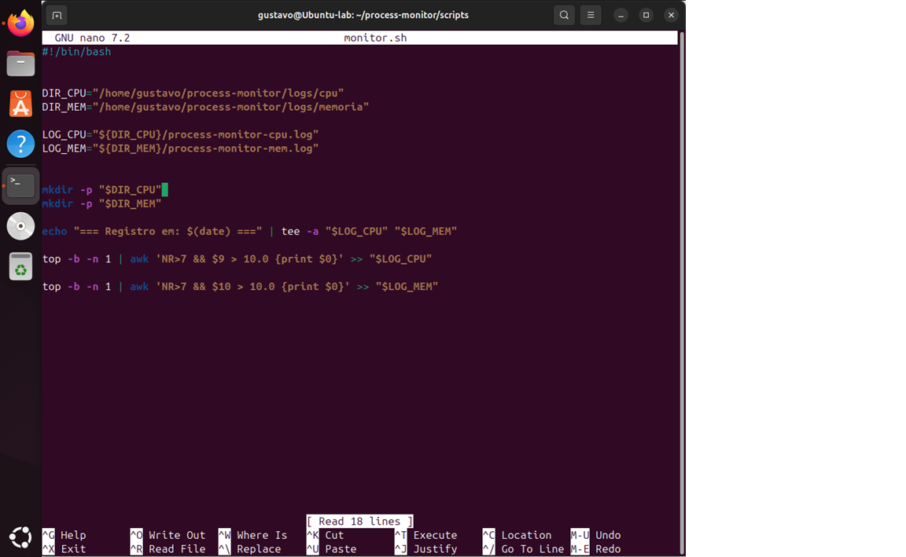
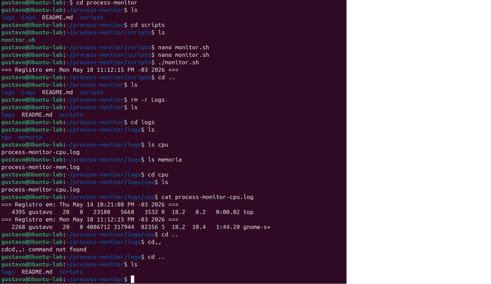
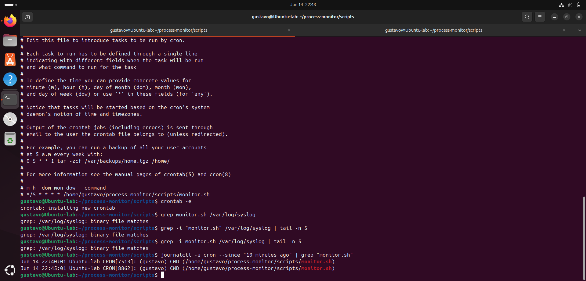
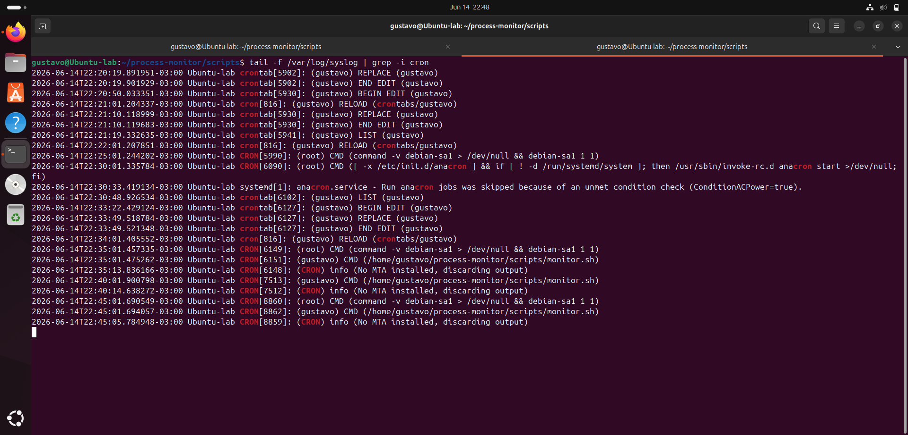

# Linux Process Monitor Lab

A Bash learning project for monitoring Linux processes, detecting CPU and memory usage above configurable thresholds, and recording alerts in separate log files.

## Overview

This lab is part of my practical studies in Linux administration and cybersecurity. It combines process monitoring, shell scripting, configuration management, and log analysis.

The script reports processes that exceed the configured resource limits. It does not terminate processes or change system settings.

## Features

- Configurable CPU and memory thresholds.
- A whitelist of process names to exclude from monitoring.
- Separate log files for CPU and memory alerts.
- Automatic creation of log directories.
- Timestamped alerts containing the process ID, command name, and resource usage.
- Terminal feedback when no monitored process exceeds the limits.
- An error message when the configuration file is missing.

## Requirements

- Ubuntu Linux.
- Bash.
- `top` from the `procps` package.
- `bc` for decimal comparisons.
- Standard command-line utilities, including `tail`, `date`, and `mkdir`.

Install the required packages:

```bash
sudo apt update
sudo apt install procps bc
```

Git is required to clone the repository.

## Project Structure

| Path | Purpose |
| --- | --- |
| `scripts/monitor.sh` | Main monitoring script. |
| `scripts/monitor.conf` | Resource thresholds and process whitelist. |
| `logs/cpu/process-monitor-cpu.log` | CPU alert records. |
| `logs/memoria/process-monitor-mem.log` | Memory alert records. |
| `prints/` | Screenshots from earlier lab sessions. |
| `README.md` | Project documentation. |

Log directories are created automatically. Log files are created when an alert is first written, unless they already exist.

## Installation and Execution

The current script expects the project at `~/labs/linux-process-monitor`.

Clone the repository:

```bash
mkdir -p ~/labs
cd ~/labs
git clone https://github.com/Gustavo-cloudsec/linux-process-monitor.git
cd linux-process-monitor
```

If the repository is already cloned, enter its directory:

```bash
cd ~/labs/linux-process-monitor
```

Run the monitor as your regular user:

```bash
bash scripts/monitor.sh
```

Each execution performs one check. Continuous monitoring requires repeated execution or a separately configured scheduler.

## Configuration

Edit `scripts/monitor.conf` to change the resource thresholds and excluded process names:

```bash
ALERT_CPU=10.0
ALERT_MEM=10.0

WHITELIST=("systemd" "dockerd" "mysql" "nginx")
```

- `ALERT_CPU`: per-process CPU percentage threshold.
- `ALERT_MEM`: per-process memory percentage threshold.
- `WHITELIST`: process names excluded from alerts.

The comparisons use `>`. A value exactly equal to the configured threshold does not trigger an alert.

The configuration file also contains `ALERT_EMAIL`, which is reserved for future use. The current script does not send email notifications.

## How It Works

1. Locates `monitor.conf` beside the monitoring script.
2. Loads the configuration or exits if the file is missing.
3. Creates the CPU and memory log directories.
4. Captures process information using `top` in batch mode.
5. Reads the process rows and checks names against the whitelist.
6. Compares CPU and memory usage with the configured thresholds using `bc`.
7. Appends each detected alert to the corresponding log file.
8. Displays resource alerts or a message indicating that no limits were exceeded.

## Example Output

### Resource Alert

```text
Alerta de Recursos em 2026-10-20 02:18:28:
- [CPU] gnome-s+ (2852) usando 18.5%
```

### No Threshold Exceeded

```text
[2026-10-20 02:22:55] Nenhum processo acima dos limites configurados.
```

### CPU Log Entry

```text
[2026-10-20 02:18:28] PID: 2852 | CMD: gnome-s+ | CPU: 18.5%
```

Timestamps use the virtual machine's configured local time.

## Checking Logs

From the project directory:

```bash
tail -n 5 logs/cpu/process-monitor-cpu.log
tail -n 5 logs/memoria/process-monitor-mem.log
```

A log file may not exist yet if no alert has been recorded for that resource.

The repository includes historical logs from earlier lab sessions. New alerts are appended to the existing files.

## Validation — October 2026

The project was restored on a new Ubuntu virtual machine and updated to:

- Replace paths tied to the previous user with `$HOME`-based paths.
- Display a message when no monitored process exceeds the configured limits.
- Confirm CPU alert output and log creation in the new environment.
- Confirm terminal feedback during a run without alerts.

## Scheduling

Earlier lab sessions included cron configuration and execution checks, documented in the screenshots below.

Cloning this repository does not install a cron job. Scheduling must be configured separately on each machine.

## Screenshots

These screenshots document earlier versions and lab sessions. Their paths, output, and script details may differ from the current implementation.

### Script Logic



### Log Output



### Cron Configuration



### Cron Execution Validation



## Current Limitations

- Log paths depend on the project being located at `~/labs/linux-process-monitor`.
- Process parsing depends on the column layout and numeric formatting produced by `top`.
- Command names may be truncated by `top`, affecting displayed names and whitelist matching.
- CPU readings can vary between tools because their measurement methods differ.
- The script does not currently validate configuration values or check all dependencies.
- Log rotation and external notifications are not implemented.

## Skills Practiced

- Linux process inspection.
- Bash variables, conditions, loops, and arrays.
- External configuration files.
- Command pipelines and output redirection.
- Decimal comparisons with `bc`.
- Process filtering and resource thresholds.
- Log organization and troubleshooting.
- Task scheduling with cron in earlier lab sessions.
- Git and GitHub version control.

## Planned Improvements

- Derive log paths from the project directory.
- Validate dependencies and configuration values.
- Improve process parsing and handle truncated names.
- Improve consistency across system locales.
- Configure and validate scheduling on the new virtual machine.
- Add log rotation.
- Add severity levels and monitoring summaries.
- Implement optional email or Telegram notifications.

## Author

Gustavo Henrique Oliveira
